# 📡 WiFi Auditor

<p align="center">🇺🇸 <a href="README.md">English</a> · 🇫🇷 <b>Français</b></p>

[](https://github.com/pr3y/Bruce) [](https://github.com/pr3y/Bruce) [](https://hashcat.net) [](LICENSE)

Une boîte à outils simple et claire pour **tester la robustesse de ton propre Wi-Fi** : le
**LilyGO T-Embed CC1101 (firmware Bruce)** capture le handshake WPA/WPA2, ton
**Mac** le casse sur le GPU (hashcat, Metal). Livré avec une petite **interface web** locale.

```
.pcap/.cap  (SD du LilyGO)  →  .hc22000  →  hashcat (mode 22000, GPU)  →  mot de passe
```

> ## ⚠️ Usage autorisé uniquement
> Cet outil sert **uniquement** à tester la robustesse de **ton propre** réseau
> Wi-Fi, ou de réseaux pour lesquels tu as une **autorisation écrite**. Capturer ou
> casser un réseau qui ne t'appartient pas est illégal (France : art. 323-1 et suivants du
> Code pénal). Les scripts ici **ne capturent jamais de trafic** — ils ne traitent que
> des fichiers que tu possèdes déjà.

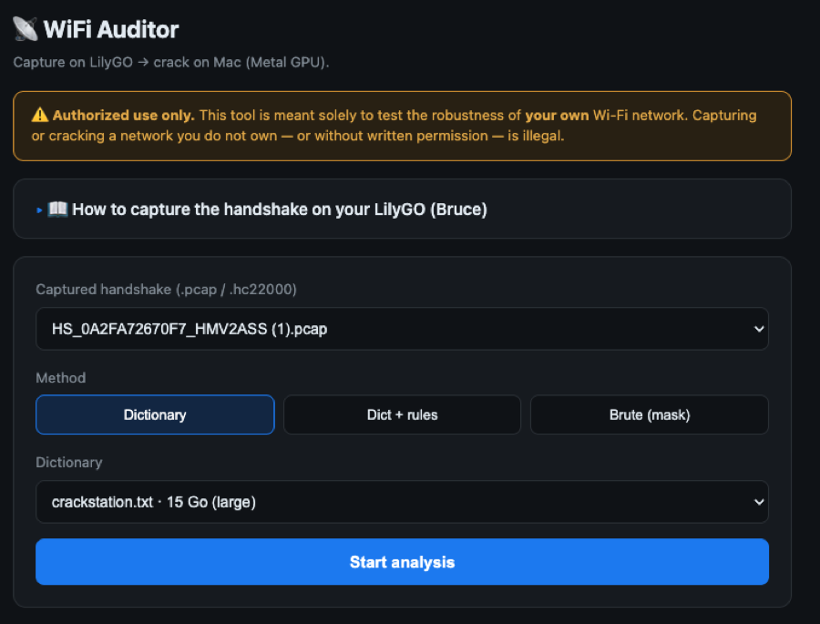

## Pourquoi c'est le Mac qui casse, pas le LilyGO

Le WPA2 utilise PBKDF2 (4096 itérations) **pour chaque mot de passe testé**.

| Plateforme | essais/s (ordre de grandeur) | dico de 15 Go (CrackStation) |
|---|---|---|
| LilyGO (ESP32-S3) | ~20–100 | des mois ❌ |
| Mac M2 Pro (hashcat Metal) | ~50 000–100 000+ | des heures ✅ |

Le LilyGO est le **capteur**. Les gros dictionnaires restent sur le Mac.

## Installation

```bash
python3 auditor.py setup      # installe hcxtools + hashcat via Homebrew
```

## Utilisation — ligne de commande

```bash
# 1) Convertir les captures de la SD en .hc22000 (détecte la SD montée toute seule)
python3 auditor.py scan
python3 auditor.py scan /Volumes/LILYGO/BrucePCAP/handshakes   # ou un dossier

# 2) Casser (détecte tes dictionnaires automatiquement)
python3 auditor.py crack ~/Downloads/hc22000
python3 auditor.py crack ./hc22000 --wordlist ~/Downloads/weakpass_2_wifi.txt
```

## Utilisation — interface web

```bash
python3 gui_server.py          # puis ouvre http://127.0.0.1:8777
```

Ou double-clique sur **`WiFi Auditor.command`**. L'interface te laisse choisir la capture,
sélectionner **Dictionnaire / Dico + règles / Brute (masque)**, et affiche la progression en
direct (candidats testés, vitesse, ETA) ainsi que le mot de passe final.

- **Dictionnaire** — simple liste de mots.
- **Dico + règles** — liste de mots × règles hashcat (idéal pour les mots de passe humains
  comme un mot + un chiffre, ex. `cerises` → `1cerises`).
- **Brute (masque)** — préréglages par format de clé (8/10 chiffres, 8/10/26 hexa, …), un
  masque libre éditable, et une **force brute complète** avec une plage de longueur au choix.
  ⚠️ La brute `?a` complète explose au-delà de 8 caractères — utile seulement pour des formats courts/connus.

### Moteur — CPU ou GPU

Un sélecteur **Moteur** choisit comment les candidats sont testés :

- **aircrack-ng (CPU, tous les cœurs)** — **par défaut**. Lit le `.pcap` brut et s'arrête au
  premier résultat. Pour les **mots de passe humains** (un mot + un chiffre, ex. `cerises` →
  `1cerises`) il est souvent **instantané**, et il évite les bizarreries WPA de hashcat
  (mots de base courts écartés avant les règles ; certaines paires de messages qu'il ne sait
  pas vérifier). Nécessite le `.pcap` original (pas un simple `.hc22000`).
- **hashcat (GPU) seul** — Metal sur Apple Silicon, massivement parallèle. Idéal pour les
  **très gros dictionnaires / masques** où le débit brut l'emporte.
- **Auto** — hashcat (GPU) d'abord, puis aircrack (CPU) en filet de sécurité si hashcat ne
  trouve rien. Les candidats sont générés par `hashcat --stdout` (règles/masques) et
  vérifiés par aircrack.

> Règle du pouce : **mot de passe humain / à base de mot → aircrack** ; **grosse
> brute/dictionnaire → hashcat**. Le défaut est aircrack, car la plupart des vrais mots de
> passe Wi-Fi sont à base de mot.

---

# 📖 Capturer le handshake sur le LilyGO (Bruce)

Le LilyGO enregistre le handshake WPA ; le Mac le casse. **Prérequis :** une carte SD
insérée, et un **client (téléphone/ordinateur) connecté** au point d'accès cible en
**2,4 GHz** (l'ESP32 ne voit pas le 5 GHz).

## ✅ Méthode A — Ciblée (recommandée)

Choisis **un** réseau et ne capture que celui-là — aucun voisin dérangé. C'est la voie la
plus propre : elle désauthentifie **seulement ton point d'accès** et récupère un M1→M4 cohérent.

> ⚠️ **Garde ton firmware Bruce à jour.** Les anciennes versions avaient un bug où
> « Handshake saved! » s'affichait mais **rien n'était écrit sur la SD**. Mettre à jour le
> firmware corrige ça — le fichier atterrit alors dans `/BrucePCAP/handshakes/`.

1. **WiFi → Wifi Atks**
   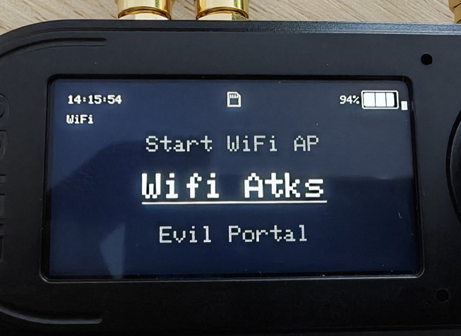
2. **Target Atks** — Bruce scanne et te laisse choisir le réseau cible.
   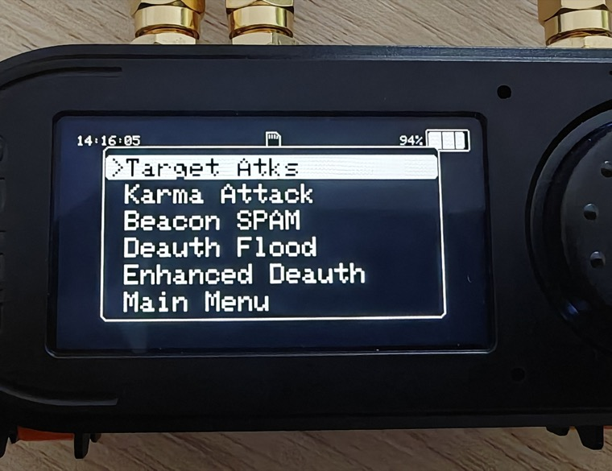
3. Choisis ton SSID, puis **Capture Handshake** (ou **Deauth+Clone+Verif** pour
   désauthentifier + capturer + vérifier d'un coup).
   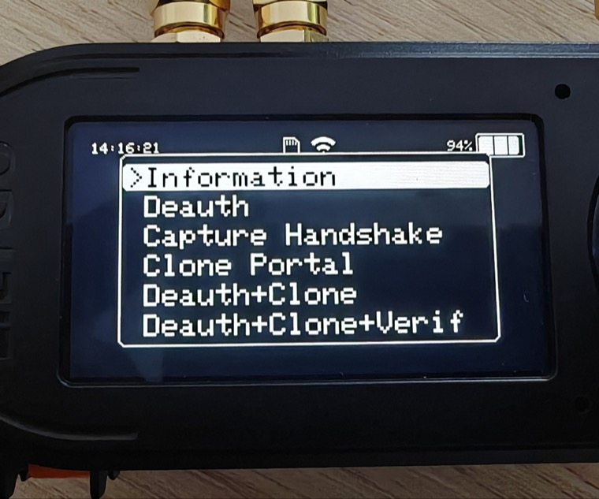
4. Il affiche la cible et **scanne**, en envoyant des désauthentifications ciblées. Regarde les
   quatre lignes **EAPOL MSG 1–4** passer du rouge au vert.
   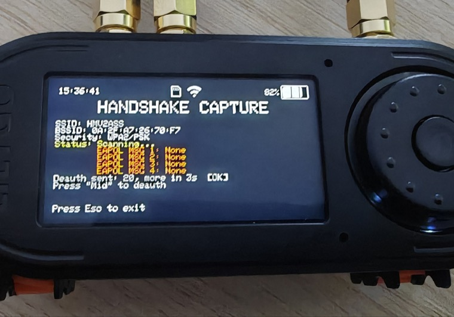
5. Quand les quatre sont vertes → **CAPTURED!** et **Handshake saved!** — un handshake propre
   est écrit dans `/BrucePCAP/handshakes/HS_<MAC>_<SSID>.pcap`. Appuie sur
   **Esc** pour sortir, puis récupère le fichier.
   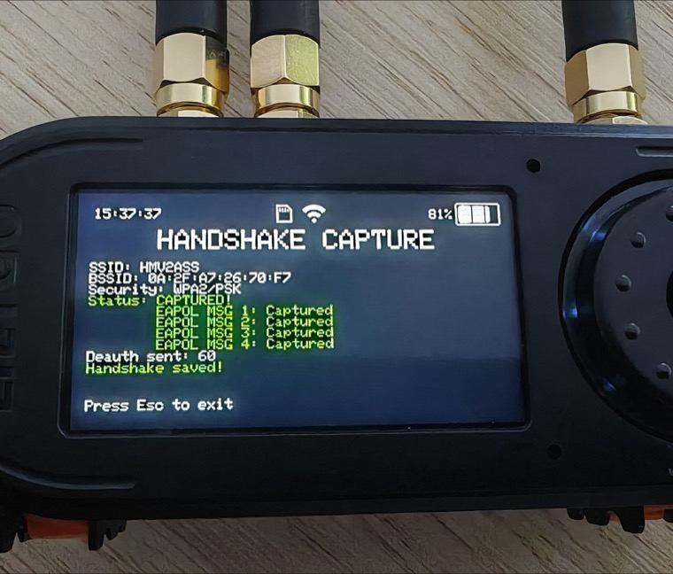

## 🛰️ Méthode B — PCAP Sniffer (large, tous les points d'accès d'un canal)

1. **WiFi → Sniffer**
   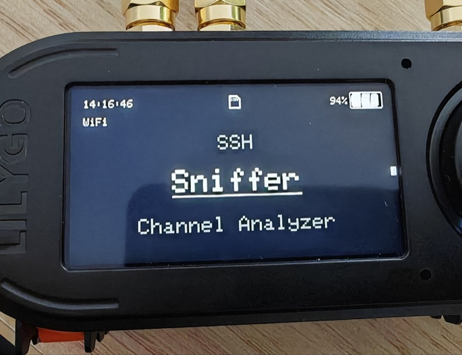
2. Le **PCAP SNIFFER** tourne. En bas à gauche, le compteur clé **EAPOL / HS** ;
   en bas à droite, le canal — tourne la **molette / appuie sur Next** pour le verrouiller sur
   **le canal de ton point d'accès** (arrête le saut de canaux).
   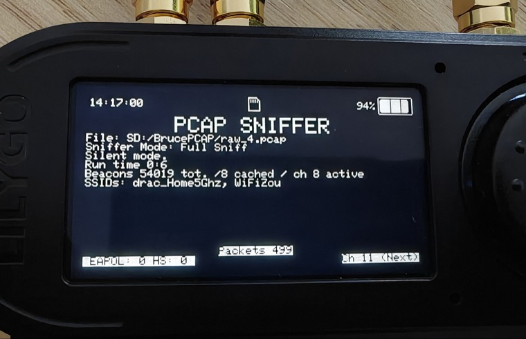
3. Appuie sur un bouton pour ouvrir les paramètres. Mets **Capture Mode → « Only EAPOL/HS »**, et
   active/désactive **Enable/Disable deauth att** ici.
   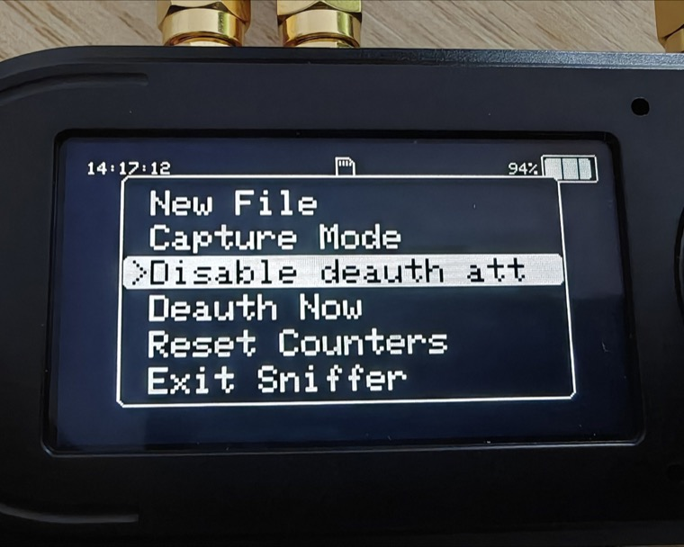
4. Appuie sur **Deauth Now** pour forcer les clients connectés à se reconnecter tout de suite.
   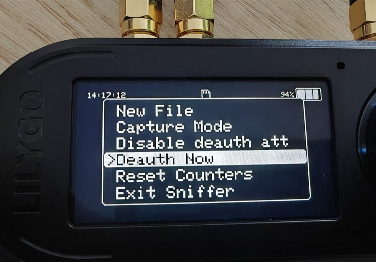

> **Plus propre et plus sympa pour les voisins (méthode B) :** évite le flood de
> désauthentification et coupe/rallume simplement le Wi-Fi **une fois** sur ton propre
> téléphone — seul ton point d'accès produit un handshake, et la capture reste propre (un flood
> de désauthentification peut mélanger les nonces de plusieurs tentatives de reconnexion et
> donner un handshake **incassable**).

## 🎯 Surveille le compteur HS, puis récupère

- Ignore le nombre de paquets (surtout des beacons). Surveille **HS** en bas à gauche. Quand
  il indique **HS : 1**, un handshake complet a été enregistré — c'est terminé.
  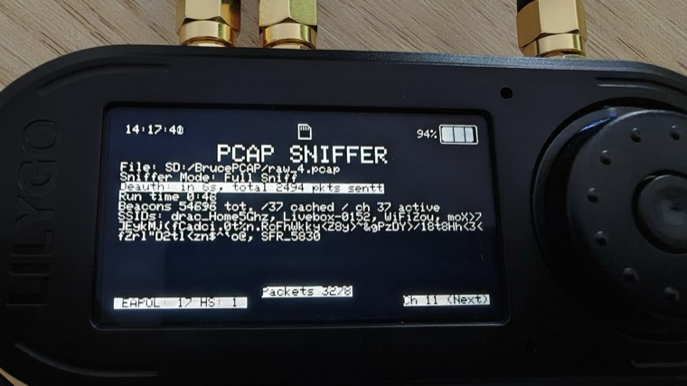
- **Récupère le .pcap** — insère la carte SD dans le Mac, ou utilise la **WebUI** de Bruce
  pour télécharger depuis `/BrucePCAP/handshakes/`
  (`HS_<MAC>_<SSID>.pcap`).
- **Charge-le dans l'app** et lance l'analyse.

---

## Dictionnaires

**Aucun dictionnaire n'est fourni** (voir [`wordlists/README.md`](wordlists/README.md)).
Dépose tes propres `.txt` dans `wordlists/`, `~/Downloads` ou `~/Documents` — ils sont
détectés automatiquement. Recommandés : **weakpass_2_wifi**, **CrackStation**, et une liste de
mots par langue + des règles pour les mots de passe humains.

## Feuille de route

- **Phase 1 (ce dépôt)** ✅ — kit Mac : convertir + casser + interface web + doc de capture complète.
- **Phase 2** — fonction du firmware Bruce (C++) : un « Handshake Grabber » en un écran
  (choisir le point d'accès → désauthentification + capture EAPOL entrelacées, sur l'appareil).

## 🛒 Matériel

*Liens partenaires Amazon : si vous achetez via ces liens, le projet touche une petite commission, sans surcoût pour vous.*

<table>
<tr>
<td align="center" width="33%">
  <a href="https://www.amazon.fr/dp/B0D45MSMJR?linkCode=ll2&amp;tag=koua29wifiauditor-21&amp;ref_=as_li_ss_tl"></a><br>
  <b><a href="https://www.amazon.fr/dp/B0D45MSMJR?linkCode=ll2&amp;tag=koua29wifiauditor-21&amp;ref_=as_li_ss_tl">Batterie Anker 545 (10 000 mAh)</a></b><br><sub>Pour faire tourner le T-Embed loin d'une prise</sub>
</td>
<td align="center" width="33%">
  <a href="https://www.amazon.fr/dp/B0C1FCZM94?linkCode=ll2&amp;tag=koua29wifiauditor-21&amp;ref_=as_li_ss_tl"></a><br>
  <b><a href="https://www.amazon.fr/dp/B0C1FCZM94?linkCode=ll2&amp;tag=koua29wifiauditor-21&amp;ref_=as_li_ss_tl">Antenne SMA 433 MHz (lot de 2)</a></b><br><sub>Antenne sub-GHz pour la radio CC1101</sub>
</td>
<td align="center" width="33%">
  <a href="https://www.amazon.fr/dp/B0B7NVMBPL?linkCode=ll2&amp;tag=koua29wifiauditor-21&amp;ref_=as_li_ss_tl"></a><br>
  <b><a href="https://www.amazon.fr/dp/B0B7NVMBPL?linkCode=ll2&amp;tag=koua29wifiauditor-21&amp;ref_=as_li_ss_tl">microSD SanDisk 64 Go (lot de 2)</a></b><br><sub>Pour les thèmes, scripts et captures Bruce</sub>
</td>
</tr>
</table>

<sub>En tant que Partenaire Amazon, je réalise un bénéfice sur les achats remplissant les conditions requises.</sub>

## ☕ Un café ?


## Crédits & licence

- Par **koua29**. Tourne sur l'excellent **[Bruce firmware](https://github.com/pr3y/Bruce)**.
- Cassage par **[hashcat](https://hashcat.net)**, conversion par **[hcxtools](https://github.com/ZerBea/hcxtools)**.
- Code sous **[MIT](LICENSE)**. Usage défensif/autorisé uniquement.
